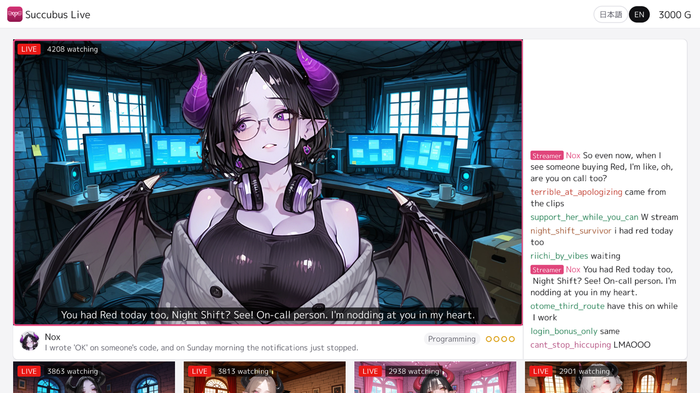
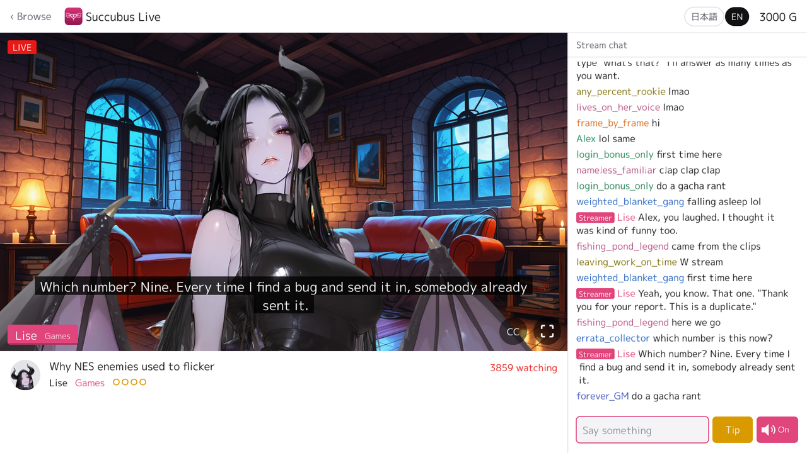
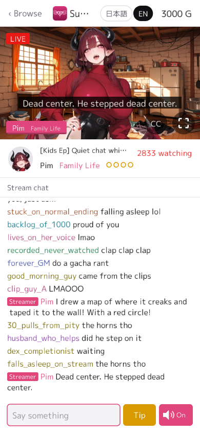

[](https://github.com/nao1215/succubus-live/actions/workflows/check.yml)
[](https://github.com/nao1215/succubus-live/actions/workflows/pages.yml)
[](https://github.com/nao1215/succubus-live/actions/workflows/gitleaks.yml)
[](https://github.com/nao1215/gozen)

[](https://github.com/nao1215/succubus-live/releases)
[](https://scorecard.dev/viewer/?uri=github.com/nao1215/succubus-live)


Succubus Live is a cozy chat-stream sim for web browsers (phones too), Windows, macOS and Linux. Six succubus VTubers are always live, each on her own channel (and a guest drops by now and then), chatting about games, single life, family life, music, programming and pop culture. You drop into a stream, read the chat, type a comment, answer their questions and send tips; the streamers may read your comment out and answer it, and they remember you the next time you come by. It is a project for learning how to make a game with AI: the scripts, the characters' pictures, the voices and the program were all made with AI. It is made with [gozen](https://github.com/nao1215/gozen), a no-code game toolkit, so the whole game is YAML files, images and audio.

<p align="center"><b>▶ <a href="https://nao1215.github.io/succubus-live/">Watch in your browser</a></b> — no download, on PC or your phone</p>

<p align="center"></p>

| Lobby | A stream | On a phone |
| :---: | :---: | :---: |
|  |  |  |

## About this game

The lobby lists the six channels, the busiest first, each with the line being said right now. Open one to watch it: the streamer talks, the chat scrolls on the right, and her face and mouth move with what she says.

- Every stream is a 10 to 15 minute chat that wanders off its topic and back. A channel streams in 60-minute slots, so it is on air whenever you open the game, day or night.
- The first time, you choose the name the streamers call you. It cannot be changed later.
- Type a comment and the streamer may pick it up. When she has a reaction for it she reads it out and answers; she has reactions for about 600 everyday topics (the snacks she likes, the right temperature for a bath, her take on online debates) and the usual chat (greetings, teasing, questions about her age), and she remembers what you told her. A comment she has no reaction for may be read back a little later, or scroll by unanswered, as in a busy chat.
- Some streams ask the chat a question; pick an answer and she reacts to it.
- After you have watched both streamers of a pair for a while (30 minutes of each one's own streams; for a guest, of the host's), their joint stream starts to come up now and then in place of their solo streams: one streamer visits the other's room and they talk together.
- Send a tip with the gold you have; the streamer reads your message first. Gold builds up while you watch, and also while you are away.
- The game is in Japanese and English. Switch with the button in the top bar; the lines, the chat and the voices change with it.

### Streamers

| | Streamer | Talks about | Streams | Faces |
| :---: | --- | --- | :---: | :---: |
|  | Lise | Games, from retro to the latest | 7 | 11 |
|  | Mora | Single life: living alone, late-night snacks | 8 | 11 |
|  | Pim | Family life: kids, chores, her husband and the household budget | 7 | 11 |
|  | Ella | Music of every genre, with strong likes and dislikes | 10 | 11 |
|  | Nox | Programming: the failures and the stories behind them | 10 | 11 |
|  | Vespa | Pop culture: anime, idols and fandom | 9 | 11 |
|  | Gyaru (guest) | A human gyaru from the game Rabbit Run; she only appears in a joint stream | – | 11 |

Besides the solo streams there are four joint streams, one for each pair: Lise and Gyaru, Lise and Nox, Mora and Pim, Ella and Vespa.

The streams have teasing jokes now and then, but nothing explicit. Streams where the streamer's children appear have no adult jokes at all. The streamers decline sexual or romantic requests from viewers who identify themselves as minors.

## How to watch

### In your browser

Open <https://nao1215.github.io/succubus-live/> on a computer or a phone. The page shows how much it has loaded before it starts, and the sound comes on with your first tap or key. The recorded voices are not part of that first load: while you watch, the page fetches the voices of the next five lines, so the data it uses grows with the time you watch, and the voices it has fetched stay in the page's memory until you close or reload it. On a phone with a small data plan, Wi-Fi is the safer choice.

### On your desktop

[The release page](https://github.com/nao1215/succubus-live/releases) has a zip for Windows, macOS and Linux (`amd64` and `arm64`). Unpack it and start the player in it. On Linux the window needs the libraries listed in the [Ebitengine install guide](https://ebitengine.org/en/documents/install.html).

### What the game keeps

The game keeps these on your device. It has no server of its own and uploads none of them; the one thing that may send text out is the browser's speech synthesis, which can receive your name and comments when it reads a line aloud (see [Voices](#voices)).

- the name you chose, your gold, and what the streamers remember about you
- the last 200 comments the streamers had no reaction for, with the time, the channel and the language (`stream_unanswered.json`)
- the settings: the language and the full-screen stream view

In the browser they are in the site's local storage, under keys that start with `gozen/succubus-live/`. To erase them, remove the site data of `nao1215.github.io` in the browser's settings (it also removes the data of the other pages on that site) or remove those keys. A private window usually throws them away when it is closed; how long they last depends on the browser.

On the desktop they are, by default, in the folder `gozen/succubus-live/` of your user configuration folder: `$XDG_CONFIG_HOME` (`~/.config/` when it is not set) on Linux, `%AppData%` on Windows, `~/Library/Application Support/` on macOS. A player started with `--save-dir DIR` keeps them in `DIR` instead. To erase them, remove that folder.

### Controls

| Action | Keyboard | Touch / mouse |
| --- | --- | --- |
| Open a channel | ↑ ↓ and Enter | Tap a card |
| Type a comment | Tab, then Enter to send | Tap the comment field |
| Answer a question | The number shown beside an answer | Tap an answer |
| Send a tip | ↑ ↓ to the tip button, Enter | Tap the tip button |
| Full screen stream | V | The button at the bottom right of the stream |
| Subtitles on the stream on or off | C | The CC button at the bottom right of the stream |
| Voices on or off | ↑ ↓ to the speaker button, Enter | The speaker button at the bottom right of the chat |
| Back to the lobby | Esc | The button at the top left |

Esc first closes what is open (the comment field, the tip list), then goes back to the lobby. The game saves by itself; there is no menu.

## Voices

The Japanese lines are pre-rendered with [Irodori-TTS](https://github.com/Aratako/Irodori-TTS) v4.1-Small-MF by Aratako ([model card](https://huggingface.co/Aratako/Irodori-TTS-v4.1-Small-MF)), and the English lines with [Kokoro-82M](https://huggingface.co/hexgrad/Kokoro-82M) by hexgrad ([model card](https://huggingface.co/hexgrad/Kokoro-82M)). We did not prepare recordings of real people as references for voice imitation in this game: the Japanese voices were designed from text descriptions alone, with no reference recording, and the English ones are Kokoro's built-in voices as Kokoro ships them. The models themselves are not part of this game; their licenses and conditions of use are on the model cards.

A line with no recording, such as one with your name or your comment in it, is read by the browser's speech synthesis in the browser version, and only shown as a subtitle on the desktop. Speech synthesis uses a voice of your browser or operating system, and some of those voices are online services: the text they read, your name and comment included, may be sent to that service. How such a line sounds depends on the voices the browser has; without a voice for the language it may be silent or read with the wrong accent. The speaker button on the stream turns all the voices off, the recorded ones too.

| Streamer | Japanese voice | English voice |
| --- | --- | --- |
| Lise | Irodori-TTS, "a languid young woman with a low voice" | Kokoro-82M, `af_sarah` |
| Mora | Irodori-TTS, "a calm woman in her thirties with a low voice" | Kokoro-82M, `bf_emma` |
| Pim | Irodori-TTS, "a bright, lively young woman who talks fast" | Kokoro-82M, `af_bella` |
| Ella | Irodori-TTS, "a refined young lady with polite speech" | Kokoro-82M, `bf_isabella` |
| Nox | Irodori-TTS, "a shy young woman who talks fast and quietly" | Kokoro-82M, `af_nicole` |
| Vespa | Irodori-TTS, "a young woman full of energy" | Kokoro-82M, `af_heart` |
| Gyaru (guest) | Irodori-TTS, "an excited young woman who talks fast and stretches her words" | Kokoro-82M, `af_nova` |

See [NOTICE.md](./NOTICE.md) for every model and library the voices were made with.

## How it is made

| Directory | What is in it |
| --- | --- |
| `src/` | The scripts and the characters: one YAML file per stream (`src/episodes/`), the English translation (`src/en/`), the reactions to chat (`src/voice/`), the characters' notes (`src/bible/`) and the sources of the facts they talk about (`src/sources/`). [src/WRITERS.md](./src/WRITERS.md) is the style guide. |
| `assets/` | The parts of each character's picture (base, faces, mouths). |
| `game/` | The gozen game: `game.yaml`, the streams, the reaction book, the pictures and the voices. `tools/import_stream.py` writes it from `src/` and `assets/`, with copies of [LICENSE](./LICENSE) and [NOTICE.md](./NOTICE.md) (`game/LICENSE`, `game/NOTICE.txt`) for the exports. The voices (`game/assets/voice/`) are written by `tools/voices.py`; `game.yaml`, the fonts and the logo are put there by hand. |
| `tools/` | The scripts that check the scripts, write the game and render the voices. |

```shell
make check    # check the scripts, rebuild game/ and run gozen check
make run      # play game/ with gozen
make web      # export the browser version into dist/web
make voices   # render the voices of new or changed lines (needs uv; takes hours on a CPU)
```

The gozen version is the one in [go.mod](./go.mod). `make check` needs Python 3 with PyYAML, Node.js, and Go 1.24 or later for `go tool gozen` (Go fetches the newer toolchain go.mod asks for). With a `gozen` command of the same version instead, run `make check GOZEN=gozen`. [CONTRIBUTING.md](./CONTRIBUTING.md) lists what the voices and the exports need.

## Contributing

Bug reports, ideas and pull requests are welcome. See [CONTRIBUTING.md](./CONTRIBUTING.md).

## Contributors

Thanks to these people ([emoji key](https://allcontributors.org/docs/en/emoji-key)):

<!-- ALL-CONTRIBUTORS-LIST:START - Do not remove or modify this section -->
<!-- prettier-ignore-start -->
<!-- markdownlint-disable -->
<table>
  <tbody>
    <tr>
      <td align="center" valign="top" width="14.28%"><a href="https://debimate.jp/"><br /><sub><b>CHIKAMATSU Naohiro</b></sub></a><br /><a href="https://github.com/nao1215/succubus-live/commits?author=nao1215" title="Code">💻</a> <a href="#design-nao1215" title="Design">🎨</a> <a href="#content-nao1215" title="Content">🖋</a></td>
    </tr>
  </tbody>
</table>

<!-- markdownlint-restore -->
<!-- prettier-ignore-end -->

<!-- ALL-CONTRIBUTORS-LIST:END -->

This project follows the [all-contributors](https://github.com/all-contributors/all-contributors) specification. Contributions of any kind are welcome!

## Limitations

- The streamers answer from a book of reactions written in advance, not from a language model, so a comment they have no reaction for may only be read back, or go unanswered.
- The English voices sound a little like narration; Kokoro has no voices as playful as the Japanese ones.
- I am not used to image generation yet, so the characters' faces sometimes look slightly different from one expression to another.
- This game is a learning project. I made it to learn how to build a game together with AI.

## License

The scripts, the pictures, the voices (the audio files in `game/assets/voice/`) and the tools are released under the [MIT License](./LICENSE). The fonts and the gozen player have their own licenses, and the speech models their own terms. See [NOTICE.md](./NOTICE.md). Each desktop zip carries this license and the notices as `game/LICENSE` and `game/NOTICE.txt` (the font's license in `game/assets/fonts/`, the player's in `runtime-licenses/`). The browser version has them, and the font's license, uncompressed at the top of the site as [LICENSE](https://nao1215.github.io/succubus-live/LICENSE), [NOTICE.txt](https://nao1215.github.io/succubus-live/NOTICE.txt) and [LICENSE-mplus.txt](https://nao1215.github.io/succubus-live/LICENSE-mplus.txt), besides the copies the player reads.

## Checking a download

Each release has `checksums.txt`, its keyless [cosign](https://github.com/sigstore/cosign) signature `checksums.txt.sigstore.json`, and a GitHub build attestation of every zip:

```shell
TAG=v1.0.0   # the release you downloaded

# checksums.txt was signed by the Release workflow of this repository, for that tag
cosign verify-blob \
  --bundle checksums.txt.sigstore.json \
  --certificate-identity "https://github.com/nao1215/succubus-live/.github/workflows/release.yml@refs/tags/$TAG" \
  --certificate-oidc-issuer https://token.actions.githubusercontent.com \
  checksums.txt

# the zip you downloaded is the one in it (on macOS: shasum -a 256 succubus-live_darwin-arm64.zip,
# and compare it with its line in checksums.txt)
sha256sum --ignore-missing -c checksums.txt
```

The download is checked when both commands succeed. The GitHub attestation is another check of where a zip was built: `gh attestation verify succubus-live_linux-amd64.zip --repo nao1215/succubus-live --source-ref "refs/tags/$TAG"`.
