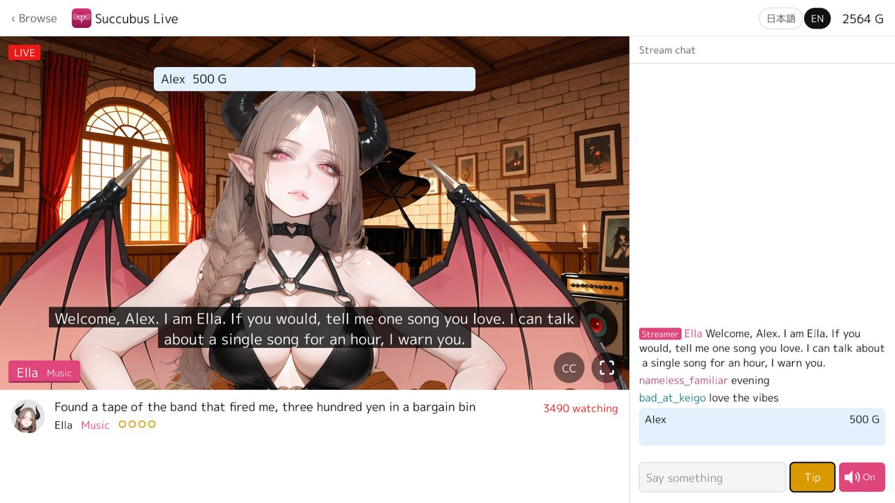
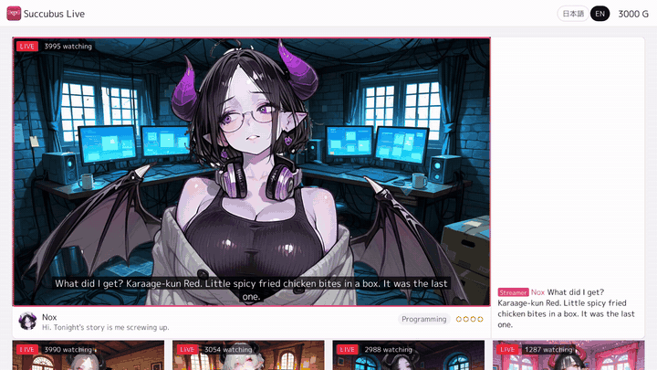
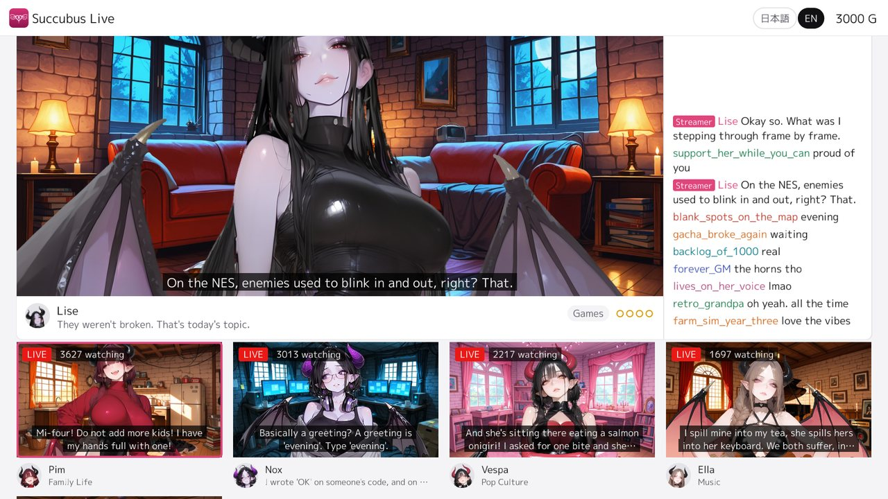
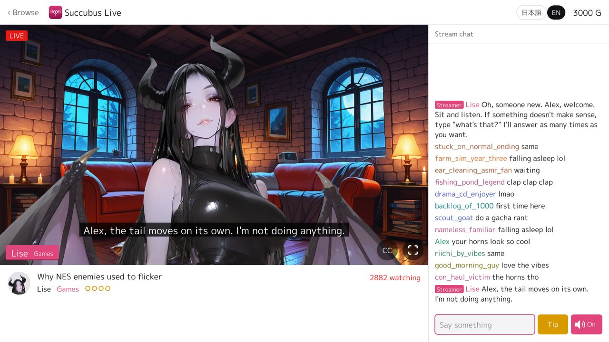
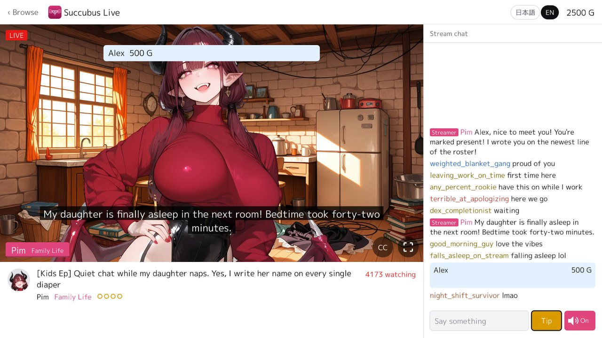
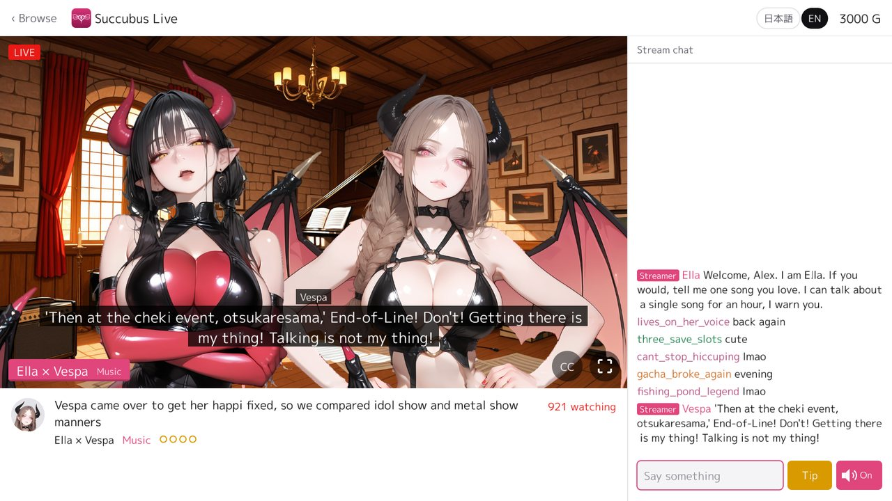

[](https://github.com/nao1215/succubus-live/actions/workflows/check.yml)
[](https://github.com/nao1215/succubus-live/actions/workflows/pages.yml)
[](https://github.com/nao1215/succubus-live/actions/workflows/gitleaks.yml)
[](https://github.com/nao1215/gozen)

[](https://github.com/nao1215/succubus-live/releases)
[](https://github.com/nao1215/succubus-live/releases)
[](https://scorecard.dev/viewer/?uri=github.com/nao1215/succubus-live)



Succubus Live is a chat-stream game for web browsers, Windows, macOS and Linux: six succubus VTubers are always live, and you watch, comment and tip, in Japanese or English. Why succubi? I had been making a strategy game with succubi, but it grew too big to finish, so I took its streamers out and finished them as a game of their own. It is a project for learning how to make a game with AI, made with [gozen](https://github.com/nao1215/gozen).

<p align="center"><b>▶ <a href="https://nao1215.github.io/succubus-live/">Watch in your browser</a></b> — no download, on PC or your phone · or get a zip for your desktop from <a href="https://github.com/nao1215/succubus-live/releases">the releases</a></p>

<p align="center"></p>

| Lobby: every channel, live, the busiest first | Chat: she reads your comment and answers |
| :---: | :---: |
|  |  |
| Tip: your name stays pinned in the chat | Collab: two streamers in one room |
|  |  |

## Streamers

| | Streamer | Talks about | Streams |
| :---: | --- | --- | :---: |
|  | Lise | Games | 7 |
|  | Mora | Single life | 8 |
|  | Pim | Family life | 7 |
|  | Ella | Music | 10 |
|  | Nox | Programming | 10 |
|  | Vespa | Pop culture | 9 |
|  | Gyaru (guest) | From Rabbit Run | collab only |

There are four collabs: Lise and Gyaru, Lise and Nox, Mora and Pim, Ella and Vespa. A pair starts to stream together after you have watched each of them for 30 minutes. The streams tease now and then but have nothing explicit.

## Controls

| Action | Keyboard | Touch / mouse |
| --- | --- | --- |
| Open a channel | ↑ ↓, Enter | Tap a card |
| Comment | Tab, type, Enter | Tap the comment field |
| Tip, voices, captions | ↑ ↓ to the button, Enter | Tap the button |
| Full screen | V | The button on the stream |
| Back to the lobby | Esc | ‹ Browse at the top left |

## Voices

The Japanese lines are voiced with Irodori-TTS and the English ones with Kokoro-82M, all rendered in advance; no recording of a real person was used. [NOTICE.md](./NOTICE.md) lists the models and their terms.

## Contributing

Bug reports, ideas and pull requests are welcome. See [CONTRIBUTING.md](./CONTRIBUTING.md).

## Contributors

Thanks to these people ([emoji key](https://allcontributors.org/docs/en/emoji-key)):

<!-- ALL-CONTRIBUTORS-LIST:START - Do not remove or modify this section -->
<!-- prettier-ignore-start -->
<!-- markdownlint-disable -->
<table>
  <tbody>
    <tr>
      <td align="center" valign="top" width="14.28%"><a href="https://debimate.jp/"><br /><sub><b>CHIKAMATSU Naohiro</b></sub></a><br /><a href="https://github.com/nao1215/succubus-live/commits?author=nao1215" title="Code">💻</a> <a href="#design-nao1215" title="Design">🎨</a> <a href="#content-nao1215" title="Content">🖋</a></td>
    </tr>
  </tbody>
</table>

<!-- markdownlint-restore -->
<!-- prettier-ignore-end -->

<!-- ALL-CONTRIBUTORS-LIST:END -->

This project follows the [all-contributors](https://github.com/all-contributors/all-contributors) specification. Contributions of any kind are welcome!

## Limitations

- The streamers answer from reactions written in advance, not from a language model, so a comment may go unanswered.
- The characters' faces sometimes look slightly different from one expression to another.

## License

[MIT License](./LICENSE), with the fonts, the gozen player and the speech models under their own terms: see [NOTICE.md](./NOTICE.md).

### Verifying release integrity

Each release has `checksums.txt`, its keyless cosign signature and a GitHub build attestation of every zip.

```shell
cosign verify-blob \
  --bundle checksums.txt.sigstore.json \
  --certificate-identity "https://github.com/nao1215/succubus-live/.github/workflows/release.yml@refs/tags/vX.Y.Z" \
  --certificate-oidc-issuer https://token.actions.githubusercontent.com \
  checksums.txt
sha256sum --ignore-missing -c checksums.txt
gh attestation verify succubus-live_linux-amd64.zip --repo nao1215/succubus-live
```
